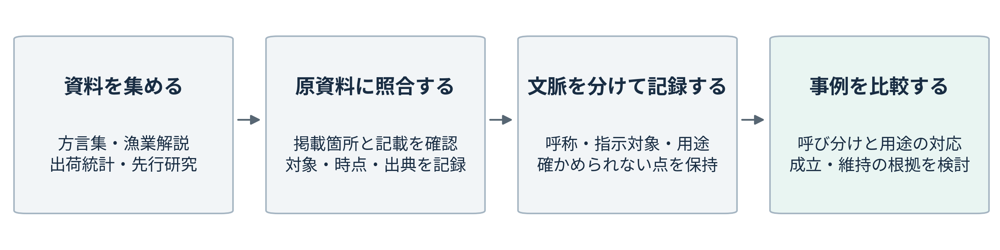
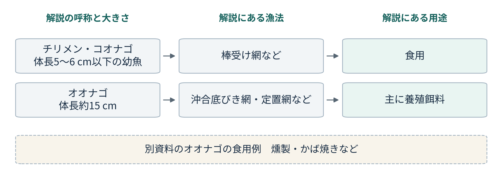
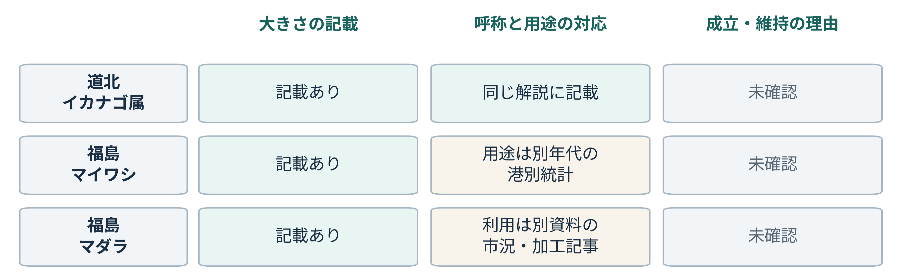

# 魚類地方名の大きさによる呼び分けと利用文化 ― 道北のイカナゴ属と福島県のマイワシ・マダラの文献事例研究 ―

## 要旨

本研究は、魚類の大きさによる呼び分けと用途の対応を、公開資料からどこまで確認できるかを問う文献事例研究である。道北のイカナゴ属と、福島県のマイワシ・マダラを対象に、方言集、漁業解説、資源調査、流通統計の記載を資料ごとの地域、時期、集計範囲に沿って整理した。道北では、稚内水産試験場の解説が小型のチリメン・コオナゴの食用と、オオナゴの主な養殖餌料への利用を対応づけていた。オオナゴには燻製や給食向け製品の記録もあった。福島では、マイワシに体長帯と対応する呼称、マダラに大小・中型に対応する呼称があった。小名浜港の現代の統計からはマイワシの用途別出荷量がわかるが、方言集の呼称ごとの仕向けはわからない。マダラの資料では同じ地方名が複数の標準和名に対応した。資料から確認できたのは、道北の一事例における大きさと主な用途の対応までである。用途によって呼び分けの基準が変わるか、用途が呼称の成立や維持に影響したかについては、比較に必要な記録が得られなかった。

**キーワード**　魚類地方名、民俗分類、体長、用途、文献事例研究

## 目次

- 第1章　はじめに
- 第2章　研究方法
- 第3章　結果
- 第4章　考察
- 第5章　結論
- 参考文献
- 付録　資料の追跡方法

## 第1章　はじめに

### 1.1　研究背景

魚の名前は、どの魚であるかを伝えると同時に、魚を扱う場面で求められる情報を伝えることがある。魚を採る段階では、漁場や漁具に関係する違いが関心の対象になり、流通や調理の段階では大きさや品質が関心の対象になり得る。安室（2014，pp.165–167，189–192）は神奈川県佐島などのアワビを取り上げ、漁師の地方名、産地市場での市場名、小売の段階での商品名を取り上げた。そこで論じられたのは、同じ品物が人の手を渡る間に名称が引き継がれたり、販売の目的に沿って選ばれたりする過程である。魚類についても、名前を記録した資料がどの段階の呼称を伝えているかを考える必要がある。

地域で使われる名称を手掛かりに、人々が生物をどのようにまとめ、区別しているかを調べるのが民俗分類研究の課題の一つである。本研究でいう地方名は、地域の語として文献に記録された呼称である。民俗分類単位とは、ある集団が一定の場面で、どのような魚を一まとまりとして扱い、ほかの魚と区別するかによって定まるまとまりを指す。方言表で一つの標準和名に複数の呼称があれば、成長に応じて呼称が変わるほか、地域や話者によって呼び方が異なる場合も考えられる。逆に、同じ語が複数の標準和名に対応することもある。複数の呼称が掲載されていても、各語の使用場面と指示する範囲がわからなければ、話者がいくつの単位に区別していたかは数えられない。

### 1.2　区別の基準と実用上の重要性

Hunn（1982，pp.830，841–844）は、人々が生物について知っている内容を、その生物に関して日常で何を行うかという問題と結びつけて研究することを提案した。実用上の重要性を適切に測るためには、用途の種類に加えて、どのような人が、どの場面で、どう利用するかを具体的に記録する必要があるという立場である。本研究でいう用途は、食用、食品への加工、餌料など、資料に記載された漁獲物の仕向けや利用の目的である。漁獲量や取引額はその一側面を記述する指標になり得るが、利用する頻度、利用者にとっての必要性、食文化上の意味を数量から直接知ることはできない。

Paz and Begossi（1996，pp.161–163，165）はブラジルのガンボアの漁業者に魚の絵札を示し、どの魚を近いと考えるか、どのような理由でまとめるかを調べた。著者らによれば、形態は重要な手掛かりであり、肉質、市場価格、生態も区別に関わっていた。こうした調査では、同じ人が魚の何に着目したかを聞くことができる。これに対し、方言表には語が記されていても、その語を用いた人の説明が残らない場合がある。公開資料による研究では、確認できる対応と、話者に聞くことができれば検討できる理由を分けておく必要がある。

### 1.3　目的と問い

当初は、実用上の重要性が高い魚ほど民俗分類で細かく区別されるのではないか（H1）、同じ魚類群でも利用の異なる地域間で区別の細かさが異なるのではないか（H2）、用途によって魚を区別する際に重視する特徴が異なるのではないか（H3）という問題意識を持った。H1・H2を調べるには、確認された民俗分類単位と調査対象の範囲をそろえ、それに対応する利用の資料を集める必要がある。既存の資料監査ではその条件を満たす組が得られなかったため、H1・H2は本論文の検証対象から外した（FFTA 2026a）。

本研究の問いは、魚類の大きさによる呼び分けと用途の対応が公開資料からどこまで確認できるか、である。道北のイカナゴ属を中心事例とし、福島県のマイワシとマダラを比較材料とする。まず、何が大小の違いとして記されているかを確かめる。次に、大きさで分けられた対象について用途の記載があるかを調べる。さらに、用途が区別の仕方に関係したと判断するには、どのような記録が不足しているかを示す。この手順によって、H3に関わる観察を探索的に整理する。

## 第2章　研究方法

### 2.1　対象と資料の選び方

先行する原資料監査では、道北のイカナゴ属に食用と餌料の双方を記した漁業解説があり、福島のマイワシとマダラには大きさ別に呼称を掲げる表があった（FFTA 2026a）。そこで、名称と用途が同じ資料にある事例に加え、名称と利用が異なる文書から得られる事例を選んだ。各魚類群は、文献に記録された呼称と指示対象を検討するための事例である。すべての魚類や地域を代表するように選んだものではない。

文献探索では、先行監査の出典を起点に、方言集の公開抜粋と関連資料、稚内水産試験場（以下、稚内水試）の解説、出荷統計の原集計表と調査方法を確認した。検索には魚の標準和名と地方名、地名に加え、「用途別出荷量」「養殖餌料」「小名浜　魚市場」などを組み合わせた。結果の採用条件は、記載内容とその位置を原資料の本文、表、掲載ページで確認でき、資料が扱う地域や取引の範囲を記録できることである。書誌の確認に使った索引と実際に内容を抽出した資料は区別し、同じ報告を引用する別資料を独立した観察として数えなかった。主な資料は表1に示す。

**表1　研究対象と使用資料**

| 事例・地域 | 名称と区別の資料 | 用途・流通の資料 | 時点・範囲 |
| --- | --- | --- | --- |
| イカナゴ属・道北（稚内周辺・宗谷海峡） | 稚内水試の魚類編とイカナゴ解説 | 同解説、稚内水試の事業報告、水産白書、産地の取材記事 | ウェブ表示更新と漁業の各資料時点。道北の複数の場所を含む |
| マイワシ・福島県（主にいわき） | 福島の方言集の福島県列、大きさ別表、逆引き | 小名浜港の用途別出荷量、県の浮魚資源調査 | 方言集は1995年刊。港の用途別出荷量は2023・2024年 |
| マダラ・福島県（いわき・相馬の掲載記録） | 福島の方言集の福島県列、大きさ別表、逆引き | 小名浜の市況表、県の資源資料、福島市の市場記事 | 方言集は1995年刊。市況表は短期集計、県資料の漁獲値は2025年 |

注　表中の地名・年は資料の記載と報告範囲を示す。福島の方言集の各語の採録年と、稚内水試のウェブ資料の記載が観察された時期は特定できない。

出典　稚内水試（2013a–c）、佐藤（2026）、水産庁（平成22年度）、北海道漁業協同組合連合会（2015）、福島県水産試験場（1995a–c，刊行日不詳）、農林水産省（2024，2025）、有賀ほか（2026）、福島県水産資源研究所（2026）、鈴木（年不詳）。

### 2.2　FFTAで管理した情報

研究資料の整理にはFish Folk Taxonomy Analyzer（FFTA）を用いた。地方名、標準和名・学名、地域、調査文脈、出典を区別し、一つの地方名と魚種との対応に複数の候補がある場合は候補を保持する構造である。同じ表記でも記録された場所や時期が異なれば、同一の用法として統合しない。利用記述については対象と出典を保持し、資料上に利用の記載が見当たらない場合も「利用なし」という項目に置き換えなかった。

復旧後の検証用データでは、照合対象の地方名79件について、資料上の掲載を確認した。これは調査資料に載った呼称の記録数である。仮置きの民俗分類単位28件は、根拠不足のため確定に至っていない（FFTA 2026a）。本研究では、その検証用データから、対象に対応する13件の名称記録（道北のイカナゴ2件、福島のマイワシ6件・マダラ5件）を起点とした。これらに原資料から確認した用途や流通などの記述を加え、事例の証拠表に50行を整理した。同じ資料から複数行を抽出しており、行数は資料数や調査協力者数を示さない（FFTA 2026b）。

照合では、方言集の同じ刊行物に由来する表でも、用途が異なることを考慮した。「標準和名から方言」の表で場所の付記を確認し、「大きさにより方言の変わる魚」の表で大きさの記載を確認した。逆引きも読み、別の標準和名への対応や大きさの表現の違いを記録した（福島県水産試験場 1995a–c）。大きさ別表には個別の採録地点欄がなく、同じ聞き取りに由来するという判断は保留した。福島県の公開案内が述べる市場での聞き取りと既存文献の整理についても、個々の語がどちらの経路で採録されたかは明らかでない（福島県水産海洋研究センター 2018）。

### 2.3　生物分類と分析の範囲

地方名の指示対象は、各資料の標準和名と学名を確認した上で、当時の記載として保持した。稚内水試の解説と福島の旧分類表ではイカナゴに *Ammodytes personatus* の名を用いている（稚内水試 2013c「分類」、福島県水産試験場 1995d，PDF p.9）。北太平洋のイカナゴ属は形態と遺伝情報を使って再検討されており（Orr et al. 2015，p.129）、本村（2026）の目録ではイカナゴに *Ammodytes japonicus* を対応させる。マイワシについても本村の目録の *Sardinops melanostictus* と、WoRMSが受容名とする *Sardinops sagax* を併記して保留した（WoRMS 年不詳）。マダラは本村の目録で *Gadus macrocephalus* とされる。歴史資料の個体を再同定したわけではないため、記載上の魚種や漁業での呼称を現在の分類に従って一律に置換する操作は行わなかった。

分析では、まず採録された呼称に対応する大きさや成長段階を記述した。次に、同じ資料が同じ対象の呼称と用途を対応づける記載と、年代・集団・集計単位の異なる資料からそれぞれに得た記載を区別した。最後に、ある特徴による区別が用途のために成立した、または維持されたとする説明を、話者の記録や時系列から確かめられるかを検討した（図1）。三事例の資料には採録条件の違いがあるため、地方名の数の地域間比較、分類粒度の算出、用途による統計的な差の検定は行わなかった。

**図1　研究資料の整理・分析手順（模式図）**

注　各段階で、資料の年・地域・対象と判定の範囲を記録した。矢印は作業の順序を表す。

出典　FFTAの原資料監査・事例証拠表（2026a，2026b）をもとに作成。

## 第3章　結果

### 3.1　照合できた資料の範囲

三事例すべてで、大きさや成長段階と呼称を対応づける記載を確認した。道北の「魚なまえ辞典」の案内には漁業協同組合や水産技術普及指導所などの協力が記されているが、各語の話者や採録年は記されていない（稚内水試 2013a）。稚内水試のウェブ資料に付す2013年は表示更新年である。福島の方言集についても、1995年は刊行年であり、表に載った呼称の採録時点を示すものではない。以後、福島の現代の漁獲・出荷の値には対象年を添え、方言集の記載と区別する。

### 3.2　道北のイカナゴ属

稚内水試の魚類編では、「こおなご」の備考に稚魚・幼魚、「しらうお」の備考に稚魚と記されている。「おおなご」にはイカナゴとキタイカナゴの標準和名が併記されている（稚内水試 2013b）。解説では、稚内周辺の漁業で外形が似て分布も重なる近縁種を一括で扱うとされる。背鰭軟条数や産卵期などは識別に使える特徴として挙げられている（稚内水試 2013c「分類」）。佐藤（2026，p.17）の事業報告では、宗谷海峡海域に分布する近縁種としてイカナゴ、オオイカナゴ、キタイカナゴを掲げ、漁業では種を区別して扱っていないと記す。古い解説と事業報告の対象種の表記は、それぞれの資料の範囲で読んだ。

用途の記載がある稚内水試の解説では、体長5〜6 cm以下の幼魚をチリメンやコオナゴと呼び、食用として棒受け網などで漁獲する。体長約15 cmの魚はオオナゴと呼ばれ、沖合底びき網や定置網などで漁獲され、主にハマチや養殖ウナギの餌料となる（稚内水試 2013c「漁業」）。この一つの解説にある名称、大きさ、漁法、用途の対応を図2に示す。佐藤（2026，p.17）は別の時点の沿岸漁業について、稚魚を対象とする敷網と、1歳以上を対象とするいかなごすくい網などを記した。各漁法で得られた魚の大きさと最終用途を同じ取引単位で追った資料は確認できなかった。

オオナゴの食用も文献に現れる。水産庁（平成22年度，PDF p.41）は、稚内で養殖ハマチの餌としての出荷が90％以上を占めたと記し、フライやかば焼きの学校給食向け製品化も取り上げている。比率が対象とした個別の集計期間や計測方法は同箇所で確認できない。白幡（2009，p.20）は、稚内機船漁業協同組合の市場で行われた催しで、オオナゴの食材としてのブランド化が図られたことを報告した。北海道漁業協同組合連合会（2015）の産地記事でも、餌料への出荷と併せて、燻製や昆布締めなどの食用が記されている。

**図2　道北のイカナゴ属の呼称・大きさ・用途（模式図）**

注　線は資料の記載上の対応を表す。示した体長は解説の目安である。食品の例は別資料による。

出典　稚内水試（2013c「漁業」）、水産庁（平成22年度，PDF p.41）、北海道漁業協同組合連合会（2015）をもとに作成。

### 3.3　福島県のマイワシ

方言集の福島県列では、マイワシの「イワシ」に「全域」と付記され、コバ、コチュウバ、チュウバ、ニタリ、オオバに「いわき」と付記されている（福島県水産試験場 1995a，PDF p.13）。大きさ別表にある体長帯を表2に示す。隣り合う範囲には13、16、18、20 cmという境界値が重なって含まれている。例えば、体長がちょうど境界に当たる場合の呼び方は表に記されていない。ニタリは大きさ別表で「大中型魚」、逆引きでは「大型魚」であり、大小の表現にも同じ編纂物の中で違いがある（福島県水産試験場 1995b，PDF p.2、福島県水産試験場 1995c，PDF p.8）。

有賀ほか（2026，pp.10–12）の報告では、2024年の福島県の属地水揚げは2,606 t、222百万円であった。同報告の小名浜魚市場における生物調査では、測定日別の被鱗体長の最頻値は16〜18 cm台であった。方言集にある体長の測り方は確認できない。現代の測定に旧呼称を付けた記録も得られなかった。

農林水産省の「まいわし（生鮮）」の集計では、小名浜港の用途別出荷量は、2023年が計3,702 t、2024年が計2,580 tであった。両年に生鮮食用、その他の食用加工品、養殖用又は漁業用餌料への出荷が記録されている（表3）。調査が扱うのは産地卸売市場で取引された量の用途別出荷であり、県内全体の属地水揚げとは範囲が異なる。表はこの品目の仕向けを示すが、旧呼称や魚体長の列はない（農林水産省 2024，2025、農林水産省 年不詳「用語の解説及び分類の定義」）。

### 3.4　福島県のマダラ

福島県列のマダラでは、ミズタラ、オオタラに「いわき」、タラ、ホンダラに「全域」、ポンタラに「相馬」と付記されている（福島県水産試験場 1995a，PDF p.14）。大きさ別表では小型魚をミズタラ、中型魚をタラ、大型魚をオオタラとする。大きさの数値は示されていない（福島県水産試験場 1995b，PDF p.2）。逆引きでは、いわきのミズタラにマダラとスケトウダラが対応し、備考には「小型タラルイ」とある（福島県水産試験場 1995c，PDF p.10）。両種を一括して指す用法と、話者や場面により異なる用法とを判別する記録は得られなかった。

福島県の市況表のうち、地区欄「小名浜」の底びき網についての3月の短期集計では、マダラの水揚量は5,751 kg、平均単価は107円/kgであった。公開ファイル名には年を示す数字があるが、表には個別の刊行日が示されない（福島県水産試験場 刊行日不詳，PDF p.1）。県の資源資料によれば、2025年の漁獲量は5.6 t、金額は1.0百万円であり、主な漁法は底びき網である（福島県水産資源研究所 2026，PDF p.1）。これらは期間と範囲の異なる集計である。福島市の卸売事業者の署名記事には、水分の多い身を淡塩で締め、シオダラとして流通させるとの説明があった（鈴木 年不詳）。原料がいわきで漁獲されたかや、旧呼称に対応する大きさ別の用途・価格はわからない。

**表2　三魚類群の呼称・区別基準・用途**

| 魚類群 | 呼称 | 資料上の大きさ・区別 | 用途との対応 |
| --- | --- | --- | --- |
| 道北のイカナゴ属 | チリメン・コオナゴ | 体長5〜6 cm以下の幼魚 | 同じ解説に食用 |
| 道北のイカナゴ属 | オオナゴ | 体長約15 cm | 同じ解説に主に養殖餌料。別資料に食品の例 |
| 福島のマイワシ | コバ | 体長13 cm以下 | 旧呼称別は未確認 |
| 福島のマイワシ | コチュウバ | 体長13〜16 cm | 旧呼称別は未確認 |
| 福島のマイワシ | チュウバ | 体長16〜18 cm | 旧呼称別は未確認 |
| 福島のマイワシ | ニタリ | 体長18〜20 cm | 旧呼称別は未確認 |
| 福島のマイワシ | オオバ | 体長20 cm以上 | 旧呼称別は未確認 |
| 福島のマダラ | ミズタラ | 小型魚。逆引きは複数種を併記 | 旧呼称別は未確認 |
| 福島のマダラ | タラ | 中型魚 | 旧呼称別は未確認 |
| 福島のマダラ | オオタラ | 大型魚 | 旧呼称別は未確認 |

注　大きさの目安は各資料の値である。福島の大きさ別表の記載と地域情報は、同じ刊行物に由来する別表で確かめた。「未確認」は当該呼称に対応する用例を資料から確かめられなかったことを示す。

出典　稚内水試（2013c「漁業」）、福島県水産試験場（1995a，PDF pp.13–14、1995b，PDF pp.1–2、1995c，PDF p.10）、水産庁（平成22年度，PDF p.41）、北海道漁業協同組合連合会（2015）。

**表3　小名浜港の「まいわし（生鮮）」の用途別出荷量（t）**

| 対象年 | 生鮮食用向け | その他の食用加工品向け | 養殖用又は漁業用餌料向け | 計 |
| --- | ---: | ---: | ---: | ---: |
| 2023年 | 370 | 740 | 2,592 | 3,702 |
| 2024年 | 258 | 516 | 1,806 | 2,580 |

注　公表表で数量が記載された三つの用途を示す。調査では用途別の回答が得られない場合に前年等の構成比で補完する。小名浜の個々の数値に補完が適用されたかは、公開表から判別できない。

出典　農林水産省（2024，2025，表2「小名浜（福島）・まいわし（生鮮）」、年不詳「集計・推計方法」）。

### 3.5　三事例で得られた証拠の比較

呼称が示す大きさは全事例で記述できた。大きさごとの主な用途まで同じ解説の中で対応づけられたのは道北のイカナゴ属の一事例である。福島では、マイワシの用途別出荷量とマダラの取引・加工に関する別資料が得られたが、方言集の旧呼称別に用途を割り当てられる記載は確認できなかった。いずれの事例でも、同じ話者集団が呼び分けの理由として用途を説明した記録は得られなかった。この資料上の差を図3に示す。

**図3　三事例で得られた証拠（比較模式図）**

注　各欄は根拠の種類を示す。「未確認」は資料の確認範囲を示し、当該の関係の有無を判定したものではない。

出典　表2・表3の出典、福島県水産試験場（刊行日不詳）、鈴木（年不詳）、FFTAの事例証拠表（2026b）をもとに作成。

## 第4章　考察

### 4.1　大きさによる呼び分けと用途

道北のイカナゴ属で得られたのは、同じ解説が大きさによる呼び分けと主な用途の違いを記しているという結果である。食用とされる小型側にも、主に養殖餌料に向かう大型側にも、共通して体長の目安が示されている（稚内水試 2013c「漁業」）。このことから、二つの仕向けと大きさとの対応は記述できる。用途に応じて別の特徴が重視されたかを考えるには、例えば、同じ大きさの魚に対して、食用に使う場面では身の状態を、餌料を選ぶ場面では別の特徴を見ていたかを確かめる必要がある。これを示す話者の説明や取引の観察は得られていない。したがって、今回の文献上の対応だけでH3が支持されたとは判断できない。

福島の二事例は、図3に示したとおり、呼び分けの記録と利用の記録を別々に得られた事例である。マイワシについては、同じ市域に関係する方言資料と港別の出荷統計があっても、前者は呼称と体長、後者は現在の品目と仕向けを記録する。マダラについても、短期間の市場取引や加工が記されていることから、小型と大型の魚で仕向けや価格が異なるかはわからない。資料に対応が見つからなかったことを、当時の利用の違いがなかったという結果にはできない。道北に対応が見つかったからといって、資料の記録の仕方が異なる福島よりも用途が呼び分けに強く作用したともいえない。

用途別に数量を示す資料には、集計の仕方にも注意が必要である。表3の公表値では、養殖用又は漁業用餌料向けの比率は2023年と2024年のいずれも約7割である。しかし、農林水産省の調査では、用途別出荷量の回答が得られない場合、前年又は直近の調査で得られた構成比を当年の上場水揚量に乗じて補完する場合がある（農林水産省 年不詳「集計・推計方法」）。個々の公表値に補完が適用されたかはわからない。比率が近いことから、用途構成が独立に二度観測された、あるいは仕向けが安定していたとは判断できない。両年の値は、それぞれ公表されている取引の内訳として用いる。

### 4.2　用途以外に呼び分けや仕向けを説明し得る要因

第一に、魚の大小は、それだけで観察して伝えやすい特徴である。マイワシの大きさ別表は、各呼称に体長帯を対応させている。マダラでは数値を示さずに、小型・中型・大型で呼称を示している。いずれも用途を参照せずに資料上の記載を読むことができる。一方、マイワシの境界値が表の上で重なることと、ニタリの大きさの表現が別表間で異なることには、話者が境界を柔軟に用いていた可能性と、異なる内容を並べた編集の結果である可能性が残る（福島県水産試験場 1995b，1995c）。資料からは、語が知られていたことの確認を越えて、日常的な選別の規則を復元することはできない。

第二に、漁法や漁場は、どの大きさの魚が採られるかと、その後の仕向けの双方に関わる可能性がある。道北では稚魚を対象とする敷網と、成長した魚を扱うすくい網などの違いが記される（佐藤 2026，p.17）。魚が成長に伴って異なる漁具で採られ、漁獲物がそのまま別の流通や加工に回るなら、用途が呼び分けのきっかけであったかが不明でも、資料上は大小の呼称と用途が対応し得る。漁具の選別と漁獲後の選別を調べるには、魚の大きさ、漁場や漁法、出荷先を同じ漁獲物に結びつける記録が必要となる。

第三に、同じ呼称で取引される魚でも、鮮度や加工工程により利用しやすさが異なり得る。稚内の産地記事はオオナゴの鮮度管理の難しさに言及している（北海道漁業協同組合連合会 2015）。蛯谷（2016，pp.5，12，15–17）のすり身試験では、オホーツク海産でオオナゴと呼んだ試料について、二段加熱と直加熱でゲルの破断の測定値に違いが報告された。マイワシについても、福島の水産試験では脂質含量を品質情報として測る方法が検討されている（守岡ほか 2026，pp.64，66）。これらは加工や取引で魚体の大きさ以外が問題になり得ることを示す。各試験で着目された物性や品質を道北・福島の話者が呼び分けの基準としていたかは、別途確かめる必要がある。

### 4.3　用途の展開と名称の扱い

玉置ほか（2022，pp.55–56）は既往資料に基づき、大型側の魚について、以前の魚かす原料としての利用、その後の漁場開発や養殖餌料の需要増大を記している。食用については、水産白書の製品紹介に加え、稚内の催しや産地の取材記録にも「オオナゴ」の呼称が現れる（水産庁 平成22年度，PDF p.41、白幡 2009，p.20、北海道漁業協同組合連合会 2015）。公開された文書では、同じ呼称が主な餌料用途と食用化の場面に現れたことを確認できる。食用に向けた取組が広がる過程で、すでに漁業について使われていた呼称が食品の紹介にも用いられたと考えられる。ただし、個々の話者の使い方を期間を追って記録した資料は得られていない。利用の変化に伴い名称の意味や使用範囲が保たれたかは判断できない。

民俗分類への関わりを考える上で、名称がどこで使われたかに注意する必要がある。安室（2014，pp.189–192）が市場名と商品名の区別を考察したように、漁業解説の呼称、漁協の催しの名称、商品の紹介で用いられた呼称には、それぞれの場面がある。オオナゴを食用として売り出す文書から、漁業者や消費者が同じ範囲の魚を指したことは確かめられない。また、ミズタラに複数の標準和名が対応する逆引きの例では、小型の魚をまとめる語として使われた可能性がある。ある話者が複数種をまとめていたのか、別々の話者に別々の用法があったのかはわからず、いずれかの民俗分類単位を確定することはできない（福島県水産試験場 1995c，PDF p.10）。

### 4.4　先行研究との関係

Hunn（1982，pp.841–844）が重視したのは、生物の名称と行為との結びつきを具体的な場面に沿って調べることであった。本研究で用いた方言表と漁業資料は、名前や行為の片方を詳しく記録することが多かった。福島のマイワシの例では、魚を何に回したかを示す統計があっても、区別の基準についての発言は記録されていない。実用上の重要性を扱うには、取引規模や用途の種類に加え、誰がどの魚をどのように選び、その違いをどの場面で呼び分けるかを明らかにする必要がある。道北の記載はこうした対応を調べる手掛かりとなる。

Paz and Begossi（1996，pp.161–163，165）の事例では、同じ地域の漁業者の語彙に加え、魚を分ける理由も集められた。本研究の文献から確かめられたのは、著者や編纂者が記した区別と用途である。例えば「オオナゴとはどの範囲を指すか」「どのような魚なら別の語を使うか」という問いについては、辞典の表から話者自身の回答を得ることはできない。民俗分類を確かめるには、普段の呼び方と、場面を変えたときの呼び方や説明を同じ人について集める調査が必要となる。

### 4.5　限界と今後の課題

主な制約は、同じ時期・場所・集団に属する区別と利用の対を十分に得られなかったことである。福島では方言集の公開抜粋を調べたため、原採録票、採録年や出典の内訳、話者の担当した仕事を確認できなかった。道北でも協力団体は記録されているが、呼称ごとの話者と採録の場面はわからない。地域別の調査範囲と記録密度にも違いがある。漁獲量や取引額は各資料の範囲では利用の背景を示すが、分類単位の数や用途の重要性を同じ尺度に換算する根拠はない。以上の理由から、本研究の結論は三事例の公開資料に限られる。

今後、福島の事例では、方言集の原採録記録と同時期の市場の銘柄台帳を探し、当時の名称と魚の大きさ、取引の単位、仕向けを対応づけることが課題である。道北の事例では、漁業者、仲買、加工業者、家庭がどの魚にどの語を使うかを、同じ地域と時期について記録することが課題となる。同じ魚を別の用途に回す場面も記録し、使う語や重要な特徴が変わるか、混同が起きやすい近縁種をどのように扱うかを尋ねる。標準和名の候補や魚体長の測り方も記録すれば、漁業上のまとまりと生物分類の対応をより詳しく検討できる。

## 第5章　結論

本研究では、道北のイカナゴ属と福島県のマイワシ・マダラを取り上げ、大きさによる呼び分けと用途の対応を公開資料から検討した。三事例には、成長段階又は大きさに応じた呼称が記されていた。道北では、同じ漁業解説が、チリメン・コオナゴと呼ぶ小型魚の食用、オオナゴと呼ぶ大型側の主な養殖餌料への利用を記していた。別の資料にはオオナゴの食用化も記されており、同じ呼称が複数の仕向けの記述に現れた。

福島では、マイワシの体長帯とマダラの大小の呼称を方言集で確認した。マダラの逆引きには、一語が複数の標準和名に対応する記載もあった。小名浜の用途別出荷量と市況、別の市場の加工の資料からは、方言集に載る呼称別の用途差を判定できなかった。用途によって区別する際に重視する特徴が変わるか、用途により呼び分けが成立・維持されたかを確認するには、同じ場面と話者について呼称の指示範囲と利用を追える記録が必要である。本研究が示したのは、道北の一つの解説に記録された大きさ別の呼称と主な用途の対応、及びその対応を他の時点・地域について論じる際の限界である。

## 参考文献

著者と年で本文に示した。年に a–d を付した項目は、同じ著者・年の資料や同一冊子の公開抜粋を区別するためのものである。刊行年、対象年度、ウェブサイトの表示更新は以下のとおり区別した。電子資料の最終確認日は2026年11月29日である。

### 学術文献・分類資料

- 安室知（2014）「再考，魚名の研究　アワビの民俗分類と商業論理」『国立歴史民俗博物館研究報告』181，pp.165–204。 [本文](https://rekihaku.repo.nii.ac.jp/record/2120/files/kenkyuhokoku_181_09.pdf)
- 蛯谷幸司（2016）『北海道産低利用魚種のすり身化およびホッケの加熱ゲル形成能の再評価に関する研究』北海道大学博士論文。 [本文](https://eprints.lib.hokudai.ac.jp/dspace/bitstream/2115/61578/1/Koji_Ebitani.pdf) · [DOI](https://doi.org/10.14943/doctoral.k12211)
- 本村浩之（2026）『日本産魚類全種目録』Online ver.43（2026年10月25日版），鹿児島大学総合研究博物館。 [版の案内](https://www.museum.kagoshima-u.ac.jp/staff/motomura/jaf.html) · [表計算ファイル](https://www.museum.kagoshima-u.ac.jp/staff/motomura/20261025_JAFList.xlsx)
- Hunn, Eugene（1982）“The Utilitarian Factor in Folk Biological Classification.” American Anthropologist, 84(4), pp.830–847. [本文](https://qualquant.org/wp-content/uploads/ethnoecology/Hunn%201982.pdf) · [DOI](https://doi.org/10.1525/aa.1982.84.4.02a00070)
- Orr, James W., Sharon Wildes, Yoshiaki Kai, Nate Raring, T. Nakabo, Oleg Katugin and Jeff Guyon（2015）“Systematics of North Pacific sand lances of the genus Ammodytes based on molecular and morphological evidence, with the description of a new species from Japan.” Fishery Bulletin, 113(2), pp.129–156. [本文](https://spo.nmfs.noaa.gov/sites/default/files/orr.pdf) · [DOI](https://doi.org/10.7755/FB.113.2.3)
- Paz, Vilma A. and Alpina Begossi（1996）“Ethnoichthyology of Gamboa Fishermen of Sepetiba Bay, Brazil.” Journal of Ethnobiology, 16(2), pp.157–168. [本文](https://ethnobiology.org/sites/default/files/pdfs/JoE/16-2/PazandBegossi1996.pdf)
- WoRMS（年不詳）“Sardinops melanostictus (Temminck & Schlegel, 1846).” World Register of Marine Species, AphiaID 309913（FishBase提供）。 [項目](https://www.marinespecies.org/aphia.php?p=taxdetails&id=309913) · [受容名の応答](https://www.marinespecies.org/rest/AphiaRecordsByName/Sardinops%20melanostictus?like=false&marine_only=true)

### 方言・漁業・流通資料

- 有賀陸・池川正人・寺本航・白𡈽遼輝（2026，公開ページの表示更新年）「主要浮魚資源動向調査（イワシ類、サバ類、アジ類等）」福島県水産海洋研究センター『令和6年度 事業報告書』，pp.10–14。 [本文](https://www.pref.fukushima.lg.jp/uploaded/attachment/729247.pdf#page=10) · [公開案内](https://www.pref.fukushima.lg.jp/sec/37380b/jiho.html)
- 稚内水試（2013a，表示更新）「魚なまえ辞典」北海道立総合研究機構 稚内水産試験場。 [掲載頁](https://www.hro.or.jp/fisheries/research/wakkanai/surveys-knowledge-of-fish/inpvt400000007sg/inpvt400000009gs.html)
- 稚内水試（2013b，表示更新）「魚類編」北海道立総合研究機構 稚内水産試験場『魚なまえ辞典』。 [掲載表](https://www.hro.or.jp/fisheries/research/wakkanai/surveys-knowledge-of-fish/inpvt400000007sg/inpvt40000000l0z.html)
- 稚内水試（2013c，表示更新）「イカナゴ」北海道立総合研究機構 稚内水産試験場「さかなの基礎知識」。 [本文](https://www.hro.or.jp/fisheries/research/wakkanai/surveys-knowledge-of-fish/inpvt400000007sg/inpvt4000000081j.html)
- 佐藤政俊（2026）「イカナゴ類」『令和6年度 事業報告書 稚内水試』，pp.17–20。 [本文](https://www.hro.or.jp/upload/56984/2024Wjigyo.pdf#page=21)
- 水産庁（平成22年度，白書の対象年度）『平成22年度 水産の動向』第1部第2章第4節，「稚内機船漁業協同組合：オオナゴの製品化とブランド化」，分割PDF p.41。 [該当箇所](https://www.jfa.maff.go.jp/j/kikaku/wpaper/h22/pdf/h22_hakusyo6_2.pdf#page=41)
- 鈴木茂幸（年不詳）「マダラ（真鱈）」福島市公設地方卸売市場協会。 [本文](https://www.f-ichiba.jp/?p=1053)
- 白幡康治（2009）「『2009 おおなご＆フードフェスタ in WAKKANAI』に参加しました」『北水試だより』79，p.20。 [本文](https://www.hro.or.jp/upload/36622/79-topic2.pdf)
- 玉置泰司・三木奈都子・大関芳沖・濱津友紀・渡邉りよ（2022，報告書完成年）「イカナゴ宗谷海峡 4. 地域の持続性」水産研究・教育機構。 [書誌・本文](https://fra.repo.nii.ac.jp/records/2013990)
- 農林水産省（2024，原集計ファイル公表年）『水産物流通調査 産地水産物用途別出荷量調査』表2「令和5年漁港別品目別用途別出荷量」。 [統計表](https://www.e-stat.go.jp/dbview?sid=0004046252) · [原集計](https://www.e-stat.go.jp/stat-search/file-download?statInfId=000040221745&fileKind=0)
- 農林水産省（2025，原集計ファイル公表年）『水産物流通調査 産地水産物用途別出荷量調査』表2「令和6年漁港別品目別用途別出荷量」。 [統計表](https://www.e-stat.go.jp/dbview?sid=0004046259) · [原集計](https://www.e-stat.go.jp/stat-search/file-download?statInfId=000040303754&fileKind=0)
- 農林水産省（年不詳）「産地水産物用途別出荷量調査の概要」。 [集計・推計方法と用語の定義](https://www.maff.go.jp/j/tokei/kouhyou/suisan_ryutu/santi_ryutu/gaiyou/index.html#10)
- 福島県水産海洋研究センター（2018，表示更新）「福島の海産動物方言集」。 [公開抜粋案内と編纂方法](https://www.pref.fukushima.lg.jp/sec/37380b/hougen.html)
- 福島県水産試験場 編（1995a）「海産魚類 標準和名から方言」『福島の海産動物方言集　魚の呼び名』福水試調査研究資料 no.243，公開抜粋。 [本文](https://www.pref.fukushima.lg.jp/uploaded/attachment/36932.pdf) · [原冊子の書誌](https://ndlsearch.ndl.go.jp/books/R100000002-I000002422598)
- 福島県水産試験場 編（1995b）「海産魚類 大きさにより方言の変わる魚」『福島の海産動物方言集　魚の呼び名』福水試調査研究資料 no.243，公開抜粋。 [本文](https://www.pref.fukushima.lg.jp/uploaded/attachment/36934.pdf)
- 福島県水産試験場 編（1995c）「海産魚類 方言から標準和名」『福島の海産動物方言集　魚の呼び名』福水試調査研究資料 no.243，公開抜粋。 [本文](https://www.pref.fukushima.lg.jp/uploaded/attachment/36930.pdf)
- 福島県水産試験場 編（1995d）「海産魚類 分類表」『福島の海産動物方言集　魚の呼び名』福水試調査研究資料 no.243，公開抜粋。 [本文](https://www.pref.fukushima.lg.jp/uploaded/attachment/36933.pdf)
- 福島県水産試験場（刊行日不詳）「漁況概況」県公開ファイル名 gyokyou2003-02.pdf。 [本文](https://www.pref.fukushima.lg.jp/download/1/gyokyou2003-02.pdf#page=1)
- 福島県水産資源研究所（2026）「マダラ」『令和8年度福島県沿岸の水産資源のしおり』，個別PDF p.1。 [本文](https://www.pref.fukushima.lg.jp/uploaded/attachment/767098.pdf) · [公開案内](https://www.pref.fukushima.lg.jp/sec/37395c/shigenhyokar8.html)
- 北海道漁業協同組合連合会（2015）「おおなご 沖合底びき網漁」2015年8月掲載。 [本文](https://www.gyoren.or.jp/letter/201508)
- 守岡良晃・千代窪孝志・長沢茜（2026，公開ページの表示更新年）「多獲性魚類の品質情報配信」福島県水産海洋研究センター『令和6年度 事業報告書』，pp.64–67。 [本文](https://www.pref.fukushima.lg.jp/uploaded/attachment/729248.pdf#page=34) · [公開案内](https://www.pref.fukushima.lg.jp/sec/37380b/jiho.html)

### 研究資料

- FFTA（2026a）「FFTA Phase 2 データ品質評価・分析準備状況」『Kyoyo-Soturon』，コミット ef2503e の原資料監査。 [品質評価](https://github.com/nunosarashi-code/Kyoyo-Soturon/blob/ef2503ea4fdd7314b50132348dc1c69892af4b0c/research/phase2/data_quality_report.md) · [分析準備状況](https://github.com/nunosarashi-code/Kyoyo-Soturon/blob/ef2503ea4fdd7314b50132348dc1c69892af4b0c/research/phase2/analysis_readiness.md)
- FFTA（2026b）「FFTA Phase 3 事例研究・証拠一覧」『Kyoyo-Soturon』，コミット ef2503e の証拠表と解釈の記録。 [証拠CSV](https://github.com/nunosarashi-code/Kyoyo-Soturon/blob/ef2503ea4fdd7314b50132348dc1c69892af4b0c/research/phase3/case_evidence.csv) · [文献レビュー](https://github.com/nunosarashi-code/Kyoyo-Soturon/blob/ef2503ea4fdd7314b50132348dc1c69892af4b0c/research/phase3/literature_review.md)

## 付録　資料の追跡方法

主な資料と該当箇所は、付属の「最終証拠照合表」で追跡できる。同表には本文・図表上の位置、事例証拠表のID、原資料のURLと頁または表の位置、判定の範囲を示した。小名浜港の出荷量は、e-Statの各年の表2で「小名浜（福島）」「まいわし（生鮮）」を選ぶと確認できる。表計算ファイルでは、どちらも154行目のD、E、H、J列である。本文の表3と付属の表ファイルは公表値を記載したものである。 [2023年表2](https://www.e-stat.go.jp/dbview?sid=0004046252) · [2024年表2](https://www.e-stat.go.jp/dbview?sid=0004046259)

FFTAの原資料監査と事例証拠表は、参考文献のFFTA（2026a，2026b）を参照されたい。文献の引用先と、本論文の編集用文書、固定版PDF及び図表の生成手順を付属の再現性報告にまとめた。
